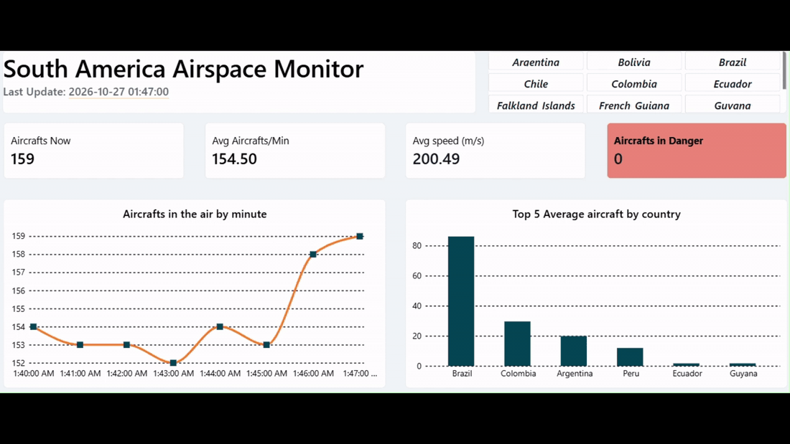
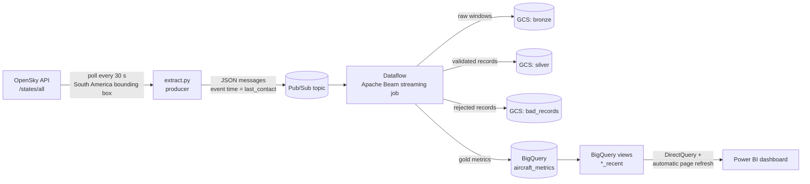

# Real-Time Flight Data Pipeline: South America Airspace Monitor

A streaming data pipeline that tracks aircraft flying over South America in near real time. Live flight states from the [OpenSky Network](https://opensky-network.org/) API flow through Pub/Sub and a Dataflow (Apache Beam) job into BigQuery, and a Power BI dashboard reads them with DirectQuery, refreshing every 30 seconds.



## Architecture



| Layer | Technology | What it does |
|---|---|---|
| Ingestion | Python, `requests`, OAuth2 client credentials | Polls OpenSky every 30 s (the free-tier limit), refreshes the access token before it expires, and publishes one message per aircraft state |
| Messaging | Google Cloud Pub/Sub | Decouples the producer from processing. `last_contact` is sent as a message attribute so Beam uses it as **event time** |
| Processing | Apache Beam on Dataflow (streaming) | Windowing, validation, deduplication per aircraft, enrichment, and aggregation |
| Storage | Cloud Storage + BigQuery | Medallion layout: bronze/silver files in GCS, gold metrics in BigQuery |
| Serving | BigQuery views + Power BI (DirectQuery) | Views expose only recent data; Power BI queries them on every page refresh |

## Data processing

Full table schemas for each layer: [bronze](docs/schemas/bronze.md) · [silver](docs/schemas/silver.md) · [gold](docs/schemas/gold.md)

### Bronze: raw events
Messages are parsed and assigned to **1-minute fixed windows** based on event time. Each window is written to GCS as one JSON file named after the window start.

### Silver: validation
Each record is checked and routed to a valid or rejected output:

- Required fields (`icao24`, `last_contact`, `on_ground`) must be present.
- Latitude and longitude, when present, must be within valid ranges.
- `velocity` and `baro_altitude`, when present, can't be negative.
- Records where the producer had to fill in a missing `last_contact` are rejected, so event time is never fabricated.

Rejected records go to a separate **bad records** folder in GCS for inspection instead of being silently dropped.

### Gold: metrics written to BigQuery

| Metric | Window | Logic |
|---|---|---|
| **Aircraft per country** | 1-min fixed | Keeps only airborne aircraft with coordinates, takes the **latest update per aircraft** in the window (dedup by `icao24`), reverse-geocodes the position to the country it's flying over, and counts per country. Countries with no aircraft are emitted as 0 so the series has no gaps |
| **Aircraft velocity** | 1-min fixed | Latest velocity (m/s) per airborne aircraft per window |
| **Vertical anomalies** | 1-min sliding, 30 s period | Per aircraft, computes vertical acceleration (Δ vertical rate / Δ time) between consecutive reports and flags values ≤ −1.0 m/s² as dangerous |

The sliding window in the anomaly metric is a deliberate trade-off: the same observation can appear in two overlapping windows. That redundancy keeps every window evaluation intact, so the dashboard can show how an aircraft's vertical behavior evolves over time.

## Tradeoffs
Windows are assigned by last_contact for all metrics. For the per-country count, time_position would be more precise, but the two differ by at most ~15 s, which only affects aircraft at window boundaries. Re-timestamping that branch would require handling late data against a watermark driven by last_contact, so a single event-time field was kept for simplicity and consistency.

### Monitoring
For every window, the pipeline logs records received, invalid records, records missing geolocation or velocity, and aircraft in the air. This makes data-quality problems from the API visible in the Dataflow logs.

## Dashboard

The Power BI report is stored as a **Power BI Project (`.pbip`)**, so the report layout and semantic model are plain text and versioned with the code:

```
flights-data-report.pbip
flights-data-report.Report/          # pages and visuals (PBIR, JSON)
flights-data-report.SemanticModel/   # tables, sources and DAX measures (TMDL)
```

Open `flights-data-report.pbip` in Power BI Desktop to explore it.

### How the live refresh works

- **DirectQuery, not Import.** All three tables use DirectQuery, so every refresh runs a query against BigQuery and nothing is cached in Power BI.
- **Views instead of custom SQL.** Each table points to a BigQuery view (`aircrafts_per_country_recent`, `realtime_aircraft_velocity_recent`, `aircraft_vertical_anomalies_recent`) that returns only the most recent minutes of data. The filter on the partition column lets BigQuery skip old partitions, so query cost stays flat as the tables grow. With no Power Query transformations, Power BI keeps the tables in DirectQuery mode.
- **Automatic page refresh** reloads the page every **30 seconds**, matching the ingestion interval.
- **Visual interactions:** the country slicer filters the KPI cards and the time series, but not the *Top 5 countries* chart, which always shows the overall ranking.

### Measures

| Measure | Table | Definition |
|---|---|---|
| Aircrafts Now | CountryCounts | Sum of `aircraft_count` in the most recent window |
| Avg Aircrafts/Min | CountryCounts | Total aircraft counted ÷ number of minutes in the visible range |
| Avg speed (m/s) | Velocity | `AVERAGE(Velocity[velocity])` |
| Aircrafts in Danger | Accel | Rows where `vertical_acceleration_danger = TRUE` |

The full DAX is in [`flights-data-report.SemanticModel/definition/tables/`](flights-data-report.SemanticModel/definition/tables/).

## Running it

### Prerequisites
- A GCP project with a Pub/Sub topic, a GCS bucket, and a BigQuery dataset (`aircraft_metrics`) with the three metric tables
- A service account with access to those resources, and its key exported as `GOOGLE_APPLICATION_CREDENTIALS`
- An [OpenSky Network](https://opensky-network.org/) API client (client ID and secret)
- Python 3.12

### Setup
```bash
python -m venv .venv
source .venv/bin/activate
pip install -r requirements.txt
cp .env.example .env   # then fill in your values
```

### Start the pipeline
```bash
# 1. Start the Dataflow streaming job
python -m dataflow.pipeline

# 2. Start the producer (polls OpenSky every 30 s)
python extract/extract.py
```

To run the pipeline locally instead of on Dataflow, switch `runner` to `DirectRunner` in `dataflow/pipeline.py`.

## Repository structure

```
extract/extract.py                    # OpenSky → Pub/Sub producer
dataflow/pipeline.py                  # Beam streaming pipeline (bronze → silver → gold)
dataflow/utils.py                     # validation, enrichment and metric transforms
dataflow/constants.py                 # thresholds, field lists, country codes
dataflow/schemas.py                   # BigQuery schemas
setup.py                              # packages worker dependencies for Dataflow
flights-data-report.pbip              # Power BI project (+ .Report / .SemanticModel folders)
docs/                                 # images for this README
```

## Next steps
- Alerts for emergency descents published to a dedicated Pub/Sub topic
- Pipeline health dashboard built from the monitoring metrics

